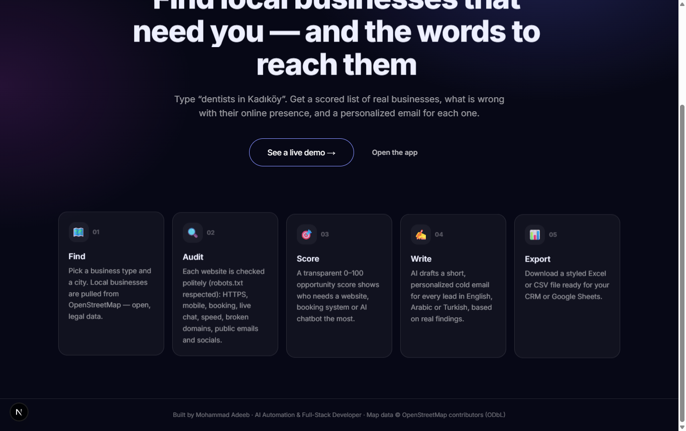
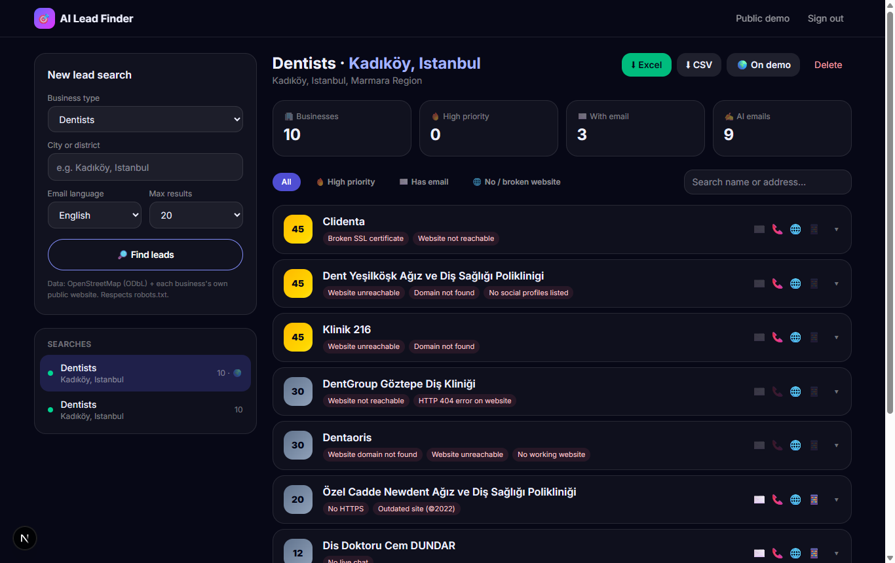
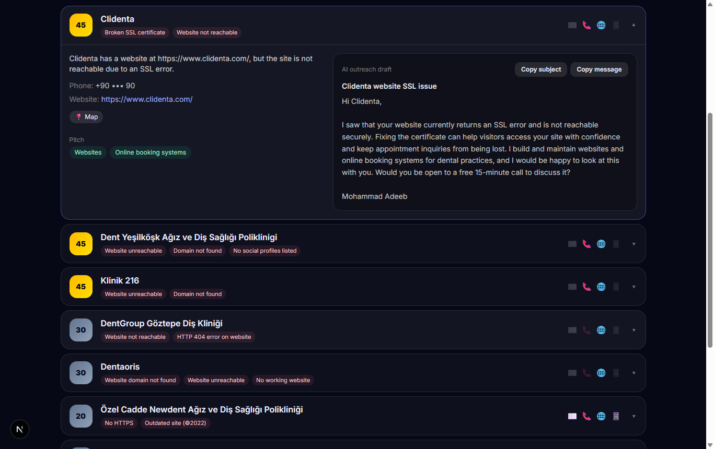

# AI Lead Finder — local leads, website audits & personalized AI outreach

Type **“dentists in Kadıköy”** and get a scored list of real local businesses. For each one you see what is wrong with its online presence, plus a **personalized cold email**, ready to export to Excel.

**🔗 Live demo:** https://ai-lead-finder-eta.vercel.app/demo (real results, contact details masked)



| Dashboard | Lead details + AI email |
|---|---|
|  |  |

## The problem
Freelancers and agencies waste hours building lead lists by hand, guessing which businesses need help, and writing generic cold emails that get ignored.

## The solution
1. **Find.** Local businesses come from **OpenStreetMap**, which is open and legal data (ODbL), not scraped from Google. Overpass mirrors are queried in parallel, and busy map servers are retried automatically.
2. **Audit.** Each business's own website is checked politely: `robots.txt` is respected, only the homepage plus at most one contact page is fetched, and timeouts are short. It detects:
   - HTTPS and broken SSL certificates
   - Dead domains
   - Mobile-readiness
   - Online booking and live chat
   - Speed and copyright year (outdated site)
   - Tech stack: WordPress, Wix, Shopify and others
   - Public business emails and social profiles
3. **Score.** A transparent, rule-based **0–100 opportunity score** shows who most needs a website, booking system or AI chatbot.
4. **Write.** For every lead, AI writes a summary, opportunities, the services to pitch, and a **specific cold email** in English, Arabic or Turkish, based only on real findings.
5. **Export.** Download a styled **Excel** file (colour-coded scores, filters, frozen header) or a **CSV**.

## Results (live test)
- **10 Kadıköy dentists** found and audited in about 1 minute.
  - The audit caught a **broken SSL certificate**, **3 dead domains** and outdated sites.
  - Every finding got its own tailored email.
- Arabic and Turkish emails are written natively, not translated word-for-word.

## Engineering highlights
- **Serverless-friendly job pipeline.** A search is a job, and the UI drives `POST /api/jobs/:id/step`, which processes 5 businesses per request. Every request stays under Vercel's time limit, and a job can resume after a refresh.
- **Parallel AI calls, one per lead,** each with a retry inside a time budget. A string-aware JSON extractor tolerates models that add extra text. A deterministic fallback means a lead is never left empty.
- **Gateway-proof prompting.** Instructions are also sent in the user turn, because some Anthropic-compatible gateways drop `system`.
- **Safe exports.** CSV formula-injection is neutralized, and a UTF-8 BOM keeps Arabic and Turkish correct in Excel.
- **Privacy.** The public demo masks emails and phones. The app sits behind an access token compared in constant time.

## Tech stack
Next.js 16 (App Router, route handlers), React, TypeScript, Tailwind CSS 4, Framer Motion, [Vengeance UI](https://www.vengenceui.com/) (Stagger Text, Liquid Button, Animated Number, Kinetic Loader), Anthropic SDK (Claude), Neon serverless Postgres, ExcelJS, node-html-parser, OpenStreetMap Nominatim + Overpass, Vercel.

## Run it
```bash
npm install
# .env.local
#   DATABASE_URL=postgres://...          (Neon or any Postgres)
#   ANTHROPIC_API_KEY=sk-ant-...
#   ANTHROPIC_BASE_URL=                  (optional, for an Anthropic-compatible gateway)
#   ADMIN_TOKEN=a-long-random-string
npm run dev    # http://localhost:3000 → /app
```
Deploy: `vercel link`, then `vercel integration add neon`, then `vercel env add ANTHROPIC_API_KEY` and `vercel env add ADMIN_TOKEN`, then `vercel deploy --prod`. Tables are created on the first request.

## Responsible use
Map data © OpenStreetMap contributors (ODbL). Only public business information is collected, and `robots.txt` is honoured. Outreach drafts are **never sent automatically**: you review and send them yourself, following anti-spam laws such as CAN-SPAM and GDPR (B2B legitimate interest, easy opt-out).

---
Built by **Mohammad Adeeb**, AI Automation & Full-Stack Developer.
